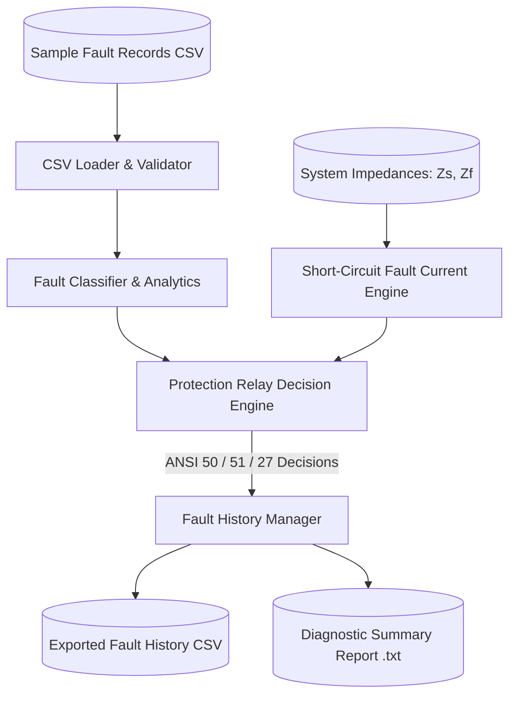

# Electrical Fault Diagnosis & Protection Analysis System

[](https://en.wikipedia.org/wiki/C99)
[](https://github.com/google/googletest)
[](Makefile)

---

## 1. Project Overview
- **Project Title:** Electrical Fault Diagnosis & Protection Analysis System
- **Engineering Domain:** Energy / Electrical Power Systems / Industrial Substation Automation
- **Course:** Programming Fundamentals and Software Engineering
- **GitHub Repository:** [https://github.com/Varun-Godbole/Electrical-Fault-Analyser](https://github.com/Varun-Godbole/Electrical-Fault-Analyser)

---

## 2. Problem Statement & Proposed Solution

### Problem Statement
In power distribution networks and industrial substations, maintenance engineers face delays in determining fault types and prospective short-circuit currents when circuit breakers trip. Manual oscillogram inspection leads to extended downtime, risks of transformer damage from reclosing into active short circuits, and difficulties in auditing relay response times.

### Proposed Solution
This software implements an automated, modular C engineering platform that:
1. **Reads Recorded Telemetry:** Ingests recorded 3-phase currents, neutral current, and voltages from CSV event logs.
2. **Rule-Based Fault Classification:** Identifies fault modes:
   - Symmetrical Three-Phase (3P) Fault
   - Line-to-Ground (L-G) Fault
   - Line-to-Line (L-L) Fault
   - Double Line-to-Ground (L-L-G) Fault
   - Sustained Overload / Phase Unbalance
   - Normal Healthy Operation
3. **Short-Circuit Calculation:** Calculates prospective short-circuit fault current from nominal voltage and complex loop impedance ($Z_s + Z_{feeder}$).
4. **Protective Relay Decision Engine:** Evaluates overcurrent (ANSI 50/51) and undervoltage (ANSI 27) thresholds, calculates IEC inverse-time trip delays, and selects recommended protection responses.
5. **History & Reporting:** Maintains an in-memory repository with ID lookup, filtering, and generates comprehensive diagnostic summary reports.

---

## 3. Software Architecture



---

## 4. Repository Structure
```
electrical-fault-diagnosis-system/
├── include/
│   ├── common_types.h        # Enums, structs, status codes, constants
│   ├── validation.h          # Input validation prototypes
│   ├── fault_analyzer.h      # Rule-based classifier & short-circuit math
│   ├── protection_relay.h    # ANSI 50/51/27 thresholds & IEC trip curves
│   ├── fault_manager.h       # In-memory history, search, and filtering
│   └── file_handler.h        # CSV parsing and diagnostic report generation
├── src/
│   ├── main.c                # Interactive CLI menu & system workflow
│   ├── validation.c          # Robust boundary validation routines
│   ├── fault_analyzer.c      # Heuristic fault identification implementation
│   ├── protection_relay.c    # Relay trip selection & curve calculations
│   ├── fault_manager.c       # Record repository & statistics aggregation
│   └── file_handler.c        # File I/O, CSV parsing & report generator
├── tests/
│   ├── gtest/
│   │   └── gtest.h           # Google Test compatible framework header
│   ├── test_main.cpp         # Test suite runner
│   ├── test_validation.cpp   # Validation positive/negative/boundary tests
│   ├── test_fault_analyzer.cpp # Fault type & current calculation tests
│   ├── test_protection_relay.cpp # Relay trip decision & curve tests
│   └── test_fault_manager.cpp # Record addition, search, filter tests
├── data/
│   ├── sample_fault_records.csv # Realistic electrical event logs
│   └── fault_history.csv     # Exported evaluated fault logs
├── docs/
│   ├── project_proposal.md   # Formal project proposal
│   └── detailed_design.md    # Detailed software design document
├── Makefile                  # Build automation (all, run, test, clean)
├── build.bat                 # Windows helper script
├── .gitignore                # Git exclusions
├── LICENSE                   # Open-source license
└── README.md                 # Complete project documentation
```

---

## 5. C Concepts Used
- **Modular Multi-File Design:** Decoupled interfaces (`include/`) from implementations (`src/`).
- **Structured Data Models:** Used `typedef struct` for electrical telemetry records, complex impedances, and assessments.
- **Enumerated Status Codes:** Consistent `Status_t`, `FaultType_t`, and `ProtectionAction_t`.
- **Defensive Input Validation:** Systematic guard checks against NULL pointers, out-of-range voltages/currents, and division-by-zero impedance singularities.
- **File Handling:** Robust CSV parsing using bounded `sscanf`, safe string copy, and formatted text report generation.

---

## 6. Coding Standards Followed
- **Indentation:** Exactly 4 spaces per indentation level.
- **Naming Conventions:**
  - Functions: `lowercase_with_underscores()`
  - Types: `CamelCase_t`
  - Constants & Macros: `UPPERCASE_WITH_UNDERSCORES`
- **Compiler Flags:** Strict warning-free compilation under `-Wall -Wextra -Wpedantic`.

---

## 7. Build and Execution Instructions

### Prerequisites
- GCC / G++ toolchain
- GNU Make

### Build Commands
```bash
# 1. Build the main application:
make all

# 2. Run the interactive application:
make run

# 3. Build and execute the Google Test unit test suite:
make test

# 4. Clean compiled binaries and objects:
make clean
```

*(On Windows, you can alternatively use `.\build.bat all`, `.\build.bat test`, `.\build.bat run`).*

---

## 8. Unit Testing Summary (Google Test)
All 13 unit tests pass cleanly:
```text
=================================================================
  GOOGLE TEST RUNNER: ELECTRICAL FAULT DIAGNOSIS & PROTECTION
=================================================================

[==========] Running 13 tests from test suite.
[ RUN      ] FaultManagerTest.AddAndFindById
[       OK ] FaultManagerTest.AddAndFindById
[ RUN      ] FaultManagerTest.FilterByTypeAndStatistics
[       OK ] FaultManagerTest.FilterByTypeAndStatistics
[ RUN      ] ProtectionRelayTest.NormalConditionNoTrip
[       OK ] ProtectionRelayTest.NormalConditionNoTrip
[ RUN      ] ProtectionRelayTest.SevereFaultInstantaneousTrip
[       OK ] ProtectionRelayTest.SevereFaultInstantaneousTrip
[ RUN      ] ProtectionRelayTest.BoundaryIecTripTimeCurves
[       OK ] ProtectionRelayTest.BoundaryIecTripTimeCurves
[ RUN      ] FaultAnalyzerTest.PositiveThreePhaseFault
[       OK ] FaultAnalyzerTest.PositiveThreePhaseFault
[ RUN      ] FaultAnalyzerTest.PositiveSingleLineToGroundFault
[       OK ] FaultAnalyzerTest.PositiveSingleLineToGroundFault
[ RUN      ] FaultAnalyzerTest.PositiveLineToLineFault
[       OK ] FaultAnalyzerTest.PositiveLineToLineFault
[ RUN      ] FaultAnalyzerTest.ProspectiveFaultCurrentCalculation
[       OK ] FaultAnalyzerTest.ProspectiveFaultCurrentCalculation
[ RUN      ] ValidationTest.PositiveTelemetryRecord
[       OK ] ValidationTest.PositiveTelemetryRecord
[ RUN      ] ValidationTest.NegativeNullArguments
[       OK ] ValidationTest.NegativeNullArguments
[ RUN      ] ValidationTest.BoundaryElectricalCurrentRanges
[       OK ] ValidationTest.BoundaryElectricalCurrentRanges
[ RUN      ] ValidationTest.BoundaryImpedanceSingularity
[       OK ] ValidationTest.BoundaryImpedanceSingularity
[==========] 13 tests ran.
[  PASSED  ] 13 tests.
```

---

## 9. Known Limitations & Future Enhancements
- **Known Limitations:**
  - Assumes lumped linear complex impedances without frequency-dependent skin effect or mutual ground coupling matrices.
  - The in-memory buffer is statically sized to 256 records for deterministic embedded/real-time memory usage.
- **Future Enhancements:**
  - Add IEC 61850 GOOSE message broadcasting simulation for automated substation bus tripping.
  - Integration with high-voltage waveform COMTRADE (Common Format for Transient Data Exchange) files.
